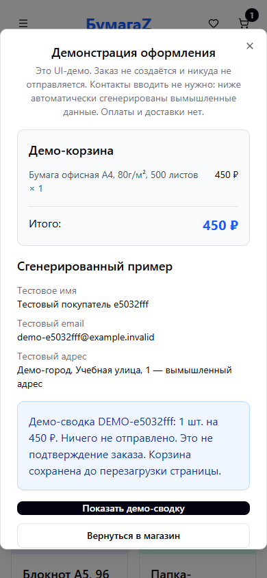

# БумагаZ — Market UI Demo

Демонстрационный магазин канцелярских товаров на React и TypeScript. Здесь можно исследовать каталог, искать и сортировать товары, менять корзину и избранное, посмотреть checkout на вымышленных данных.

**Это интерфейс вымышленного магазина. Backend, приём заказов, оплата, доставка, личный кабинет и сбор контактов отсутствуют.** Checkout генерирует тестовый профиль с адресом `example.invalid`; кнопка показывает локальную демо-сводку, не подтверждает заказ и не очищает корзину.

## Демонстрация

Существующий сайт: [VortexFront / market](https://vortexfront.github.io/market/). До одобрения и публикации PR сайт может показывать предыдущую версию; проверенные ниже изменения относятся к этой ветке.




Снимки сделаны из настоящей локальной production-сборки с тестовыми данными. Ручной smoke-test через native Browser не выполнен: локальный browser use выключен. Автоматические Playwright-сценарии и визуальный просмотр снимков выполнены отдельно.

## Реализованные функции

- 12 демонстрационных товаров, категории, скидки, поиск, сортировка по цене и названию, состояние пустого поиска. Счётчики категорий показывают количество в этом наборе; отдельная категория может быть пустой.
- Избранное: добавление, удаление и перенос в корзину.
- Корзина: количество, удаление, пересчёт суммы и повторное добавление.
- Адаптивное меню и окна на Radix UI: фокус, Escape, доступные названия действий.
- Честный checkout: контакты не вводятся, данные не отправляются и не логируются; новый синтетический профиль при каждом открытии.

Корзина, избранное и фильтры хранятся только в памяти React. Перезагрузка страницы сбрасывает их. Наличие товара, цены, скидки, условия и название магазина — демонстрационные данные.

## Стек и запуск

React18, TypeScript5, Vite6, Tailwind CSS4, Radix UI, Lucide, Sonner. Проверено на Node24; установка не требует `.env` или ключей.

```sh
npm ci --ignore-scripts
npm run dev -- --host 127.0.0.1
```

Production-сборка учитывает GitHub Pages base `/market/`:

```sh
npm run build
npm run preview -- --host 127.0.0.1
```

Откройте адрес с `/market/`, который покажет preview. Dev-сервер использует `/`.

## Проверки

```sh
npm run lint
npm run typecheck
npm test
npm run build
npm audit
npx playwright install chromium
npm run test:e2e
```

Два Node-теста проверяют синтетический профиль и запрет возврата ложного подтверждения/логов контактов. Три Playwright-истории проверяют каталог/поиск/сортировку/картинки, избранное/корзину/сброс после reload, mobile checkout без ввода контактов, запросов записи и ложного успеха; повторное открытие сбрасывает демо-сводку. Внешние сетевые попытки и необработанные ошибки отслеживаются. Для установленного Chrome можно задать `PW_CHROMIUM_EXECUTABLE`.

`npm run typecheck` охватывает весь `src/` и конфигурацию Vite, включая неиспользуемые UI-заготовки. Их ранее отсутствующие зависимости явно объявлены. Recharts2 сохранён для совместимости существующей заготовки; его переход на поддерживаемую ветку — отдельная задача, графики в магазин не включены.

CI ветки/PR имеет только `contents:read` и выполняет проверки. Развёртывание Pages — отдельный существующий workflow только для `push` в `main`; отправка рабочей ветки и открытие PR его не запускают. Merge и production-публикация требуют одобрения владельца.

## Авторство и изображения

Максим Асатуров — автор и разработчик проекта. AI-assisted tooling использовался для реализации, отладки, тестов и документации. Авторство сторонних компонентов не присваивается.

Все товарные и категорийные изображения — собственные локальные SVG-иллюстрации, заменившие внешние фотографии. Они условные и не изображают конкретные коммерческие изделия. Происхождение и лицензии: [ASSETS.md](ASSETS.md), [уведомление Lucide](THIRD_PARTY_NOTICES/lucide.txt). Лицензия исходного проекта не менялась.
